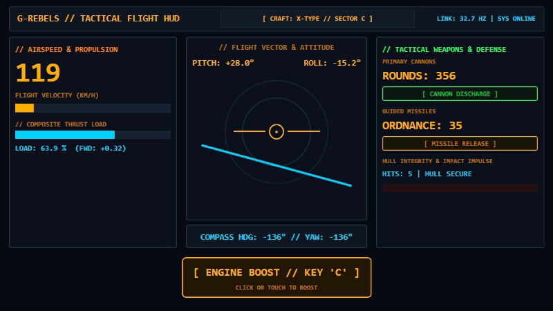
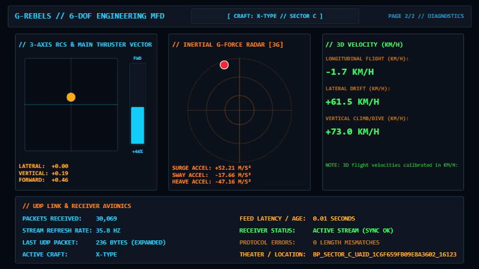

# simhub-grebels: G-Rebels Telemetry Plugin for SimHub

A telemetry bridge plugin for **G-Rebels** (Steam App ID `2445980`) and **SimHub**.

This plugin listens for incoming UDP telemetry packets from G-Rebels, parses the flight data, and exposes properties and events to SimHub for **tactile transducers / bass shakers (ShakeIt)** and **custom dashboards**.

> [!WARNING]
> **Motion Platforms Untested**: Physical motion platforms and actuator rigs are currently **untested** and outside the base verified scope of this plugin. While raw 6-DOF flight attitude and acceleration telemetry (pitch, roll, yaw, surge, sway, heave) are published, users configuring motion rigs do so experimentally and should exercise caution with actuator scaling and safety limits.

---

## Features

- **Tactile Weapon & Impact Effects**:
  - `PrimaryFired` and `SecondaryFired` pulses (0–100) and SimHub events for cannons and missiles.
  - `HitReceived` event and strength-weighted `HitImpulse` for haptic feedback upon receiving enemy fire.
- **Flight Dynamics & Inertial Telemetry**: Exposes 3D attitude (pitch, roll, yaw, compass heading) and local linear accelerations (surge, sway, heave) for cockpit displays and analytics.
- **Flight & Control Inputs**: Forward/reverse throttle (-1..+1), normalized throttle percentage (0..100%), composite 3-axis thruster percent, and vertical/lateral thruster axes.
- **Pause & Scene-Transition Safe**: Intelligently handles in-game pauses and combat scene loads without false weapon firing or corrupted baselines.
- **Attitude Freeze on Telemetry Pause**: Telemetry pauses hold the last known flight attitude rather than snapping to neutral 0°, preventing sudden jumps in cockpit instruments.
- **JSON-Driven Field Map**: All packet offsets, data types, scales, and clamps are defined in `SimHub.GRebels.json` - field mappings can be customized without recompiling C#.

---

## Requirements

- **SimHub** (v8 or v9+) on Windows
- **G-Rebels** on PC (Steam)
- Telemetry output configured to **Expanded** mode (game update 2026-10-27+)
- Technical Protocol Reference: [Reakktor Official Telemetry Specification](https://reakktor.com/htm/gr_telemetry.htm)

---

## Installation

### Method 1: Using Pre-Built Binaries

1. Close SimHub completely.
2. Download the latest release `.zip` from GitHub Releases.
3. Copy `SimHub.GRebels.dll` and `SimHub.GRebels.json` into your SimHub installation folder:
   ```text
   C:\Program Files (x86)\SimHub\
   ```
4. If using another G-Rebels plugin, you may need to disable it to avoid conflicts.
5. Launch SimHub. If prompted to enable the newly detected plugin **G-Rebels Telemetry**, click **Yes**.
   - You can also enable or disable it anytime in SimHub by clicking **Add / Remove features** in the left sidebar and toggling **G-Rebels Telemetry**. Once enabled, a **G-Rebels** tab appears in the left navigation sidebar.
   - *(Optional)* To pin G-Rebels directly to the SimHub main menu, open **Add / Remove features** and select **Show in left main menu** for the G-Rebels entry.

---

## In-Game Configuration

In G-Rebels, configure telemetry output:

1. Launch **G-Rebels**.
2. Open **Options > Input > Peripherals > Telemetry**.
3. Set the following options:
   - **Enable Telemetry**: `On`
   - **Output**: `Expanded` *(Required: default `Sim Racing Studio` profile only sends 11 basic motion channels and lacks vitals, boost, weapons, and impact vectors)*
   - **IP**: `127.0.0.1` *(or your SimHub machine IP if running on a dual-PC setup)*
   - **Port**: `33001` *(Default)*

> [!WARNING]
> **IP Configuration Notice**: The official Reakktor documentation page contains a typographical error stating the default IP is `27.0.0.1`. Do not enter `27.0.0.1`; always use `127.0.0.1` (local loopback) on a single PC.

---

## Published Properties & Events

All properties are prefixed with `GRebels.` in SimHub formulas (e.g., `$prop('GRebels.Pitch')`).

### Attitude & Flight Kinematics
| Property | Range | Description |
|---|---|---|
| `GRebels.Pitch` | `-180 .. +180` | Craft pitch angle in degrees (nose up/down). |
| `GRebels.Roll` | `-180 .. +180` | Craft roll angle in degrees. |
| `GRebels.Yaw` | `-180 .. +180` | Craft yaw angle in degrees. |
| `GRebels.Heading` | `-180 .. +180` | Craft compass heading in degrees. |
| `GRebels.Speed` | `0 .. 100000` | Craft speed. |
| `GRebels.LongitudinalAcc` | `-1000 .. +1000` | Longitudinal acceleration (Surge). |
| `GRebels.LateralAcc` | `-1000 .. +1000` | Lateral acceleration (Sway). |
| `GRebels.VerticalAcc` | `-1000 .. +1000` | Vertical acceleration (Heave). |

### 3D Velocities
| Property | Range | Description |
|---|---|---|
| `GRebels.LateralVelocity` | `-100000 .. +100000` | Strafe / sway velocity. |
| `GRebels.VerticalVelocity` | `-100000 .. +100000` | Climb / sink vertical velocity. |
| `GRebels.LongitudinalVelocity`| `-100000 .. +100000` | Forward / reverse longitudinal velocity. |

### Control Inputs & Thrust
| Property | Range | Description |
|---|---|---|
| `GRebels.ThrustMain` / `Throttle` | `-1.0 .. +1.0` | Signed forward thrust: `-1.0` (full reverse), `0.0` (neutral), `+1.0` (full forward). |
| `GRebels.ThrottlePercent` | `0 .. 100` | Normalized forward throttle percentage: `0%` reverse, `50%` neutral, `100%` forward. |
| `GRebels.ThrottleTotalPercent` | `0 .. 100` | Composite 3-axis thrust magnitude percent (sqrt(main^2 + vert^2 + lat^2) * 100%). |
| `GRebels.ThrustVertical` | `-1.0 .. +1.0` | Signed vertical thruster input (-1 down, +1 up). |
| `GRebels.ThrustLateral` | `-1.0 .. +1.0` | Signed lateral/strafe thruster input (-1 left, +1 right). |

### Spacecraft Vitals & Engine Boost
| Property | Range | Description |
|---|---|---|
| `GRebels.Shield` | `0.0 .. 1.0` | Raw shield energy level. |
| `GRebels.ShieldPercent` | `0 .. 100` | Shield energy percentage for cockpit gauges. |
| `GRebels.Hull` | `0.0 .. 1.0` | Raw hull structural integrity. |
| `GRebels.HullPercent` | `0 .. 100` | Hull integrity percentage for cockpit gauges. |
| `GRebels.BoostActive` | `0 or 1` | `1` when engine boost/afterburner is engaged, `0` otherwise. |
| `GRebels.BoostLevel` | `0.0 .. 1.0` | Raw boost reserve charge level. |
| `GRebels.BoostPercent` | `0 .. 100` | Boost tank reserve percentage. |

### Weapons & Combat Haptics
| Property | Range | Description |
|---|---|---|
| `GRebels.PrimaryCount` | `0 .. 2147483647` | Cumulative cannon rounds fired. |
| `GRebels.PrimaryFired` | `0 or 100` | Pulses to 100 on cannon discharge (duration: `WeaponPulseMs`). |
| `GRebels.SecondaryCount` | `0 .. 2147483647` | Cumulative missiles fired. |
| `GRebels.SecondaryFired` | `0 or 100` | Pulses to 100 on missile discharge (duration: `WeaponPulseMs`). |
| `GRebels.HitCount` | `0 .. 2147483647` | Cumulative projectile hits taken. |
| `GRebels.HitStrength` | `0 .. 1000` | Damage/energy rating of the latest projectile hit. |
| `GRebels.HitFired` | `0 or 100` | Pulses to 100 upon taking damage. |
| `GRebels.HitImpulse` | `0.0 .. 100.0` | Decaying haptic impulse proportional to incoming hit strength. |
| `GRebels.CollisionCount` | `0 .. 2147483647` | Cumulative physical collision counter. |
| `GRebels.CollisionStrength` | `-1000 .. +1000` | Contact force from game packet. |
| `GRebels.CollisionStrengthAbs`| `0 .. 1000` | Absolute collision magnitude for dashboard gauges and UI bars. |
| `GRebels.CollisionLastStrength`| `0 .. 1000` | Latched strength of the most recent collision. |
| `GRebels.CollisionFired` | `0 or 100` | Pulses to 100 upon collision impact (duration: `CollisionPulseMs`). |
| `GRebels.CollisionImpulse` | `0.0 .. 100.0` | Decaying haptic impulse proportional to collision strength. |
| `GRebels.CollisionDirection` | `string` | Dominant impact direction during pulse: `Front`, `Rear`, `Left`, `Right`, `Bottom`, `Top`, or `None`. |
| `GRebels.CollisionDirectionCode`| `0 .. 6` | Numeric impact direction: `0`=None, `1`=Front, `2`=Rear, `3`=Left, `4`=Right, `5`=Bottom, `6`=Top. |
| `GRebels.ImpactDirX` | `float` | Native impact normal vector X (forward / rear). |
| `GRebels.ImpactDirY` | `float` | Native impact normal vector Y (right / left). |
| `GRebels.ImpactDirZ` | `float` | Native impact normal vector Z (up / down). |

### Craft & Session Metadata
| Property | Type | Description |
|---|---|---|
| `GRebels.Game` | String | Game origin identifier (`"G-Rebels"`). |
| `GRebels.VehicleName` | String | Active spacecraft name (e.g. `"Razorback"`, `"Viper"`). |
| `GRebels.Location` | String | Active sector / venue name (e.g. `"Neo-Veridia Orbit"`). |

### SimHub Events
The plugin triggers native SimHub events that can be directly mapped to ShakeIt or action triggers:
- `PrimaryFired`
- `SecondaryFired`
- `HitReceived`
- `CollisionReceived`

### Diagnostics & Connection State
| Property | Type | Description |
|---|---|---|
| `GRebels.PluginVersion` | String | Installed plugin version and git commit hash (e.g. `1.0.1 (ce78d2a)`). |
| `GRebels.PacketCount` | Integer | Total telemetry packets received. |
| `GRebels.PacketRate` | Double | Live telemetry rate in packets per second (Hz). |
| `GRebels.FeedStale` | Boolean | `true` when no packet has arrived within `StaleSeconds`. |
| `GRebels.FeedAge` | Double | Seconds since the last received packet. |
| `GRebels.LastPacketSize` | Integer | Size in bytes of the most recent UDP payload (264 bytes in Expanded mode). |
| `GRebels.PacketLengths` | String | Distribution breakdown of received packet sizes. |
| `GRebels.LayoutMismatchCount` | Integer | Count of packets received with non-standard payload lengths. |

---

## Configuring ShakeIt Bass Shakers

### Option 1: Import Pre-Configured Profile (Optional)

A pre-tuned single-shaker profile is provided in this repository:
- [`docs/G-Rebels - Single Shaker.siprofile`](docs/G-Rebels%20-%20Single%20Shaker.siprofile)

**To import:**
1. Open SimHub and navigate to **ShakeIt Bass Shaker > Profiles**.
2. Click **Import profile** and select `docs/G-Rebels - Single Shaker.siprofile`.
3. Activate the profile **G-Rebels (Single Shaker)** and map your shaker output channel.

### Option 2: Custom Effect Formulas

To create custom tactile effects manually in SimHub:

1. In SimHub, navigate to **ShakeIt Bass Shaker > Custom Effects**.
2. Click **Add Effect** and select **Custom formula**.
3. Choose the property to drive the motor:
   - **Cannon Kick**: Bind to `[GRebels.PrimaryFired]` or use the `PrimaryFired` trigger event.
   - **Missile Launch**: Bind to `[GRebels.SecondaryFired]`.
   - **Damage Feedback**: Bind to `[GRebels.HitImpulse]` or `HitReceived` trigger event.
   - **Collision Shudder**: Bind to `[GRebels.CollisionImpulse]` or `CollisionReceived` trigger event.
4. Adjust output frequency (e.g. 35–45 Hz for cannon thumps, 60–80 Hz for projectile hits, 25–40 Hz for heavy collision thuds).

---

## Demonstration Dashboard (G-Rebels Tactical HUD)

A high-contrast CRT cockpit flight director and engineering MFD tailored specifically for G-Rebels 6-DOF space combat is packaged in this repository.

- **Dashboard Package (1-Click Import)**: [`docs/G-Rebels Tactical HUD.simhubdash`](docs/G-Rebels%20Tactical%20HUD.simhubdash)
- **Detailed User & Tablet Guide**: [`docs/DASHBOARD_GUIDE.md`](docs/DASHBOARD_GUIDE.md)

### Key Capabilities
- **Calibrated Airspeed & 3D Velocities**: Large 64pt in-game KM/H display on Screen 1 and signed 3-axis velocity breakdown (forward, lateral drift, climb/dive) on Screen 2.
- **Dynamic Hull Impulse Decay**: Calibrated to 25.0 damage reference; linear 2.5-second fade-out with instant re-triggering upon consecutive projectile impacts.
- **Weapon Counters**: Session rounds for cannon fire and missile release.
- **Interactive Engine Boost Control**: Integrated touch/click button bound to Windows Key `"C"`, usable from PC screens or Android tablets.
- **UDP Link & Avionics Diagnostics**: Real-time packet count, stream rate (60 Hz), packet size, feed latency, and connection status.

### Previews

#### Screen 1: Tactical Flight HUD (Primary Flight Director)


*[Static screenshot](docs/tactical_hud_screen1.png)*

#### Screen 2: 6-DOF RCS & Systems Diagnostics (Engineering MFD)


*[Static screenshot](docs/tactical_hud_screen2.png)*

### Quick Start
1. Ensure SimHub is running.
2. Double-click [`docs/G-Rebels Tactical HUD.simhubdash`](docs/G-Rebels%20Tactical%20HUD.simhubdash) to import into SimHub.
3. In SimHub Dash Studio, click **Start** > choose **Windowed / Overlay** or open on your Android tablet using the SimHub app.
4. See [`docs/DASHBOARD_GUIDE.md`](docs/DASHBOARD_GUIDE.md) for full control bindings, telemetry definitions, and layout specs.

---

## Building from Source

### Prerequisites
- [.NET SDK](https://dotnet.microsoft.com/download) (tested with .NET 8 / 9 SDK).
- SimHub installed locally (optional; auto-detected if installed at `C:\Program Files (x86)\SimHub\` or `/mnt/c/Program Files (x86)/SimHub/`).

### Build Options

#### Option A: Building with Local SimHub Installation (Default)
If SimHub is installed in the default location, `dotnet build` automatically detects your local assemblies:

```bash
# Clone the repository
git clone https://github.com/john-/simhub-grebels.git
cd simhub-grebels

# Restore dependencies and build Release configuration
dotnet restore
dotnet build -c Release
```

If your SimHub is in a custom folder, supply your own path using `-p:SimHubPath` or set the `SIMHUB_DIR` environment variable:

```bash
# Windows custom path
dotnet build -c Release -p:SimHubPath="D:/SimHub/"

# Or via environment variable
set SIMHUB_DIR=D:\SimHub
dotnet build -c Release
```

#### Option B: Building Without SimHub Installed (Stand-alone Source Build)
If you do not have SimHub installed on the machine, you can download `simhub-references.zip` from the project's [Releases](https://github.com/john-/simhub-grebels/releases) page:

1. Create a `lib/` directory inside the repository root.
2. Extract the assemblies from `simhub-references.zip` into `lib/`.
3. Run `dotnet build -c Release`. The project will automatically detect and compile against `lib/`.

Build outputs will be generated in `bin/Release/`:
- `SimHub.GRebels.dll`
- `SimHub.GRebels.json`
- `SimHub.GRebels.pdb`

---

## Deployment

After building the plugin (or extracting release binaries), deploy the component into SimHub using either the automated deployment script or manual steps.

### Automated Deployment (Batch Script)

The repository provides [`deploy.bat`](deploy.bat) to automate building Release artifacts and deploying them directly into your SimHub installation.

#### What `deploy.bat` does:
1. **Detects or validates SimHub target directory**:
   - Accepts an optional command-line directory argument (position-independent): e.g. `deploy.bat "C:\Program Files (x86)\SimHub"`
   - Checks the `SIMHUB_DIR` environment variable
   - Checks common installation paths (`C:\Program Files (x86)\SimHub`, `C:\Program Files\SimHub`, `D:\SimHub`, etc.)
   - Prompts for path if not detected automatically
2. **Validates running processes**: Checks if `SimHubWPF.exe` is running to prevent file-lock errors.
3. **Flexible build / prebuilt operational modes**:
   - **Auto (Default)**: Compiles `SimHub.GRebels.csproj` in Release mode if a Windows .NET SDK is detected. If no Windows .NET SDK is available, it automatically deploys pre-compiled binaries from `bin\Release` (ideal for cross-environment workflows like building in WSL and deploying on Windows).
   - **`--prebuilt`**: Skips SDK detection and always deploys pre-compiled binaries from `bin\Release`.
   - **`--build`**: Enforces a fresh build using the Windows .NET SDK (fails if the SDK is not present).
4. **Source staleness check**: When deploying pre-built binaries, verifies that repository source files (`*.cs`, `*.csproj`, `*.json`) are not newer than `SimHub.GRebels.dll`. Can be bypassed with `--allow-stale`.
5. **Backs up existing files**: Automatically creates `.bak` copies (`SimHub.GRebels.dll.bak`, `SimHub.GRebels.pdb.bak`, `SimHub.GRebels.json.bak`) before overwriting, protecting custom JSON configuration.
6. **Copies artifacts**: Deploys `SimHub.GRebels.dll`, `SimHub.GRebels.pdb` (if present), and `SimHub.GRebels.json` to the target directory.

#### Usage:

From Command Prompt or PowerShell in the repository directory:
```cmd
:: Auto-detects SimHub path, builds (or uses prebuilt binaries if no SDK) and deploys:
deploy.bat

:: Deploy prebuilt binaries (common workflow: build in WSL, deploy on Windows):
deploy.bat --prebuilt

:: Force a Windows .NET SDK build and deploy:
deploy.bat --build

:: Specify target directory explicitly (works with or without flags in any order):
deploy.bat "C:\Program Files (x86)\SimHub"
deploy.bat --prebuilt "D:\SimHub"
deploy.bat "D:\SimHub" --build

:: Allow deploying prebuilt binaries even if source files have newer timestamps:
deploy.bat --prebuilt --allow-stale

:: Show available options and help:
deploy.bat --help
```

### Verifying Release Integrity & Checksums

To verify that your downloaded package or deployed DLL has not been corrupted or tampered with, compare its SHA-256 checksum against [`SHA256SUMS.txt`](https://github.com/john-/simhub-grebels/releases) provided with each release.

#### PowerShell (Built-in on Windows 10/11):
```powershell
# Verify the downloaded release zip archive
Get-FileHash -Path "SimHub.GRebels-v1.1.0.zip" -Algorithm SHA256

# Or verify the deployed DLL
Get-FileHash -Path "C:\Program Files (x86)\SimHub\SimHub.GRebels.dll" -Algorithm SHA256
```

#### Command Prompt:
```cmd
certutil -hashfile "SimHub.GRebels-v1.1.0.zip" SHA256
certutil -hashfile "C:\Program Files (x86)\SimHub\SimHub.GRebels.dll" SHA256
```

#### GitHub CLI (Cryptographic Build Provenance):
If you have the [GitHub CLI](https://cli.github.com/) installed, you can cryptographically verify that the release binary was built and signed by the official GitHub Actions workflow via Sigstore:
```bash
gh attestation verify "SimHub.GRebels-v1.1.0.zip" --repo john-/simhub-grebels
```

### Manual Deployment Steps

1. **Close SimHub completely** before copying or updating plugin files.
2. **Back up existing files** in your SimHub installation directory (especially any custom `SimHub.GRebels.json`).
3. **Disable conflicting plugins**:
   - You may need to disable any other G-Rebels plugins in SimHub to avoid port or telemetry conflicts.
4. **Copy files** from `bin/Release/` to your SimHub installation directory (default: `C:\Program Files (x86)\SimHub\`):
   - `SimHub.GRebels.dll`
   - `SimHub.GRebels.json` (must reside next to the DLL)
5. **Launch SimHub**:
   - If prompted to enable the newly detected plugin **G-Rebels Telemetry**, select **Yes**.
   - Verify the plugin is active in the left sidebar (under **Add / Remove features** or by clicking the **G-Rebels** tab).
   - *(Optional)* Under **Add / Remove features**, check **Show in left main menu** for G-Rebels to keep it pinned in the main sidebar.
   - Confirm that `GRebels.*` properties appear in the SimHub Available Properties list.

### Manual Removal

To remove or uninstall the G-Rebels component from SimHub:

1. **Close SimHub completely**.
2. **Navigate to the SimHub installation directory**:
   ```text
   C:\Program Files (x86)\SimHub\
   ```
3. **Delete the component files** from your SimHub installation directory:
   - `SimHub.GRebels.dll`
   - `SimHub.GRebels.json`
   - `SimHub.GRebels.pdb` (if present)
4. **Restart SimHub**:
   - The plugin and its published `GRebels.*` properties will no longer be loaded.

---

## Support, Issues & Discussions

- This plugin is communuty developed and has nothing to do with the creators of the G-Rebels game.
- **Bug Reports & Feature Requests**: If you experience a bug, unexpected behavior, or wish to request a feature, please submit an issue on the [GitHub Issues](https://github.com/john-/simhub-grebels/issues) tracker. When opening an issue, please include:
  - Your SimHub version
  - In-game telemetry setting (`Expanded`)
  - Any error messages from SimHub's log or the G-Rebels plugin status tab
- **Questions & Community Discussions**: For general questions, hardware advice (such as tuning ShakeIt bass shaker profiles, transducer setups, or motion rigs), and custom dashboard sharing, please join the conversation on [GitHub Discussions](https://github.com/john-/simhub-grebels/discussions).

---

## Technical Notes

For the protocol analysis, packet structure, and offset reverse-engineering notes, see [`docs/SIMHUB_COMPONENT.md`](docs/SIMHUB_COMPONENT.md).

---

## License

This project is licensed under the **GNU General Public License v3.0 (GPLv3)**. See the [LICENSE](LICENSE) file for details.
