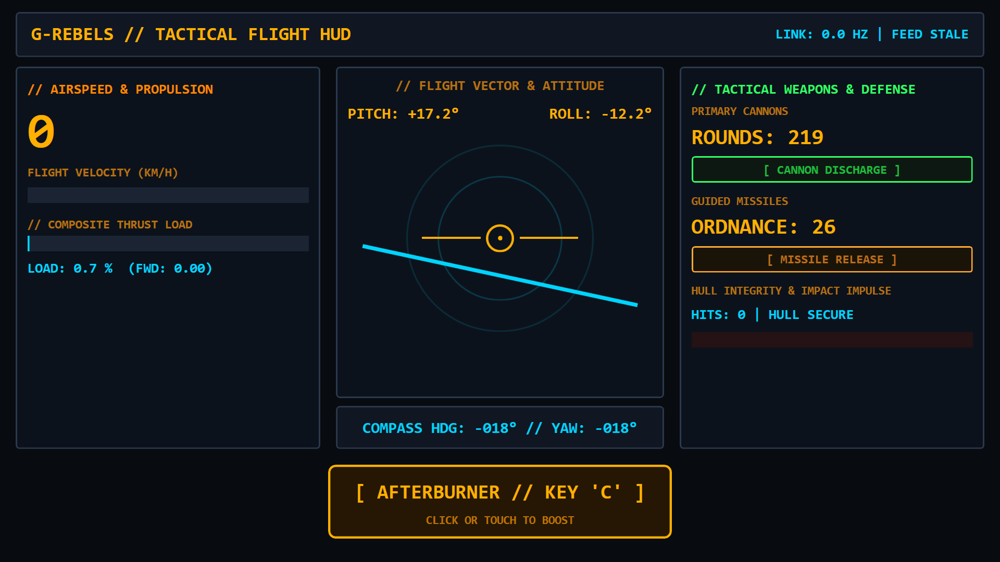
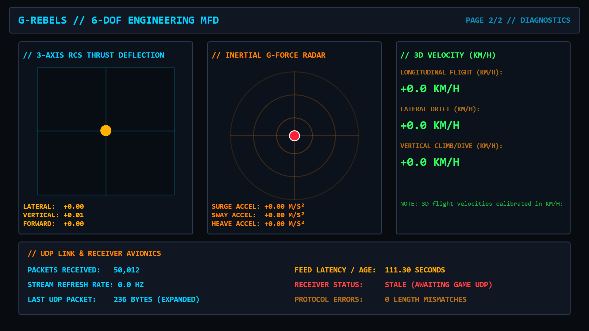

# G-Rebels Demonstration Dashboard Guide

This guide describes the **G-Rebels Tactical HUD** demonstration dashboard included in `docs/G-Rebels Tactical HUD.simhubdash`.

Designed specifically for the 6-DOF space combat mechanics of **G-Rebels**, this dashboard provides a high-contrast CRT cockpit flight display visualizing 3D attitude, thruster loads, calibrated flight velocities, weapon discharge pulses, and incoming damage, alongside an interactive touch/click **Engine Boost (Key "C")** switch.

---

## 1. Quick Start: Importing into SimHub

### Method A: One-Click Import (Recommended)
1. Ensure **SimHub is running**.
2. Double-click [`docs/G-Rebels Tactical HUD.simhubdash`](G-Rebels%20Tactical%20HUD.simhubdash) in Windows Explorer.
3. SimHub will display the **Import dashboard** dialog: click **Import**.
4. The dashboard is now installed in your SimHub Dash Studio library.

### Method B: Drag and Drop
1. Open **SimHub**.
2. Navigate to **Dash Studio** > **Dashboards** tab.
3. Drag and drop `G-Rebels Tactical HUD.simhubdash` directly onto the SimHub dashboard list.
4. Click **Import** when prompted.

---

## 2. Launching the Dashboard

### On an Android Tablet or Smartphone (SimHub App)
1. Ensure your tablet and PC are on the same local Wi-Fi.
2. In SimHub on your PC, go to **Dash Studio** > **Dashboards**.
3. Find the **G-Rebels Tactical HUD** tile, click **Start** > **"On phone or tablet"**.
4. In the **SimHub Android App**, the dashboard will load automatically (or select **G-Rebels Tactical HUD** from the dashboard list in the app).

### On PC (Windowed Overlay or Dedicated Monitor)
- Click **Start** on the `G-Rebels Tactical HUD` tile and choose **"Windowed / Overlay"** or select a dedicated screen (DDU, second monitor).

---

## 3. Screen 1: Tactical Flight HUD (Primary Flight Director)

Optimized for tablet readability with enlarged high-contrast typography and instruments:



```text
+--------------------------------------------------------------------------------+
| G-REBELS // TACTICAL FLIGHT HUD                              LINK: 60.0 HZ | OK |
+---------------------+------------------------------------+---------------------+
| // AIRSPEED & PROP  |    // FLIGHT VECTOR & ATTITUDE     | // TACTICAL WEAPONS |
|                     |  PITCH: +08.5°       ROLL: -04.2°  |                     |
|     420             |                                    | PRIMARY CANNONS     |
|     KM/H            |              ( O )                 | ROUNDS: 48          |
| [================-] |        -------[---]-------         | [ CANNON DISCHARGE ]|
|                     |        ~~~~~~~~~~~~~~~~~~~ HORIZON |                     |
| THRUST LOAD: 88.5%  |                                    | GUIDED MISSILES     |
| [================-] |       COMPASS HDG: 284° // YAW     | ORDNANCE: 4         |
|                     +------------------------------------+ [ MISSILE RELEASE ] |
|                     |                                    |                     |
|                     |    [ ENGINE BOOST // KEY 'C' ]     | HULL IMPACT STRAIN  |
|                     |       CLICK OR TOUCH TO BOOST      | HITS: 2 | IMP: 18.5 |
+---------------------+------------------------------------+---------------------+
```

### Key Instruments:
1. **Calibrated Airspeed (`KM/H`)**:
   - The large 64pt primary number displays your craft's calibrated airspeed in **km/h** (`SpeedRaw * 0.036`), directly matching the in-game HUD.
   - The linear speed gauge reflects `0 .. 1000 KM/H`.
2. **Attitude Horizon & Pitch Ladder**:
   - Center artificial horizon bar rotates with roll (`GRebels.Roll`) and translates with pitch (`GRebels.Pitch`).
   - Center boresight reticle and reference wings provide immediate spatial orientation.
3. **Compass & Heading Tape**:
   - 360° heading indicator (`GRebels.Heading`) and relative yaw angle (`GRebels.Yaw`).
4. **Primary Cannons & Session Round Counter**:
   - Round counter starts cleanly at **`0`** for each flight session and counts up with each round fired.
   - The `[ CANNON DISCHARGE ]` indicator strobes brightly with alternating high-contrast pulses on every shot fired.
5. **Guided Missiles**:
   - Tracks missiles expended during the session, with an amber discharge strobe.
6. **Hull Strain & Dynamic Impact Decay**:
   - Calibrated against standard 25.0 projectile impact energy (100% full scale).
   - When taking incoming fire, the **IMPULSE** bar spikes immediately in red and smoothly fades out over **2.5 seconds** back to zero (`HULL SECURE`).
   - If successive hits land while the bar is fading, it instantly re-triggers to the magnitude of the newest impact and resets the fade timer.
   - Flashes an emergency red alert across the top bezel during active impacts (`GRebels.HitFired`).
7. **Engine Boost Touch/Click Switch ("C")**:
   - Large, tactile button centered in the lower console.
   - Tapping on a tablet or clicking with a mouse simulates Windows key **`"c"`** directly to G-Rebels for boost.
   - Flared in bright amber when 100% full throttle is applied.

---

## 4. Screen 2: 6-DOF RCS & Systems Diagnostics (Engineering MFD)

Provides detailed engineering telemetry for 6-DOF thrusters and flight dynamics:



1. **3-Axis RCS Thruster Grid (Left)**:
   - Coordinate crosshair reticle showing lateral strafe (`GRebels.InputLateral`) on X and vertical thrust (`GRebels.InputVertical`) on Y, with digital readings for all 3 axes.
2. **Inertial G-Force Radar (Center)**:
   - Radar ball plotting longitudinal surge (`GRebels.LocalSurgeMs2`) and lateral sway (`GRebels.LocalSwayMs2`), with heave acceleration readout.
3. **3D Flight Velocity Components in KM/H (Right)**:
   - Calibrated into km/h (`* 0.036`):
     - Forward velocity component (`Expanded.Float07`).
     - Lateral drift velocity (`Expanded.Float08`).
     - Vertical climb / dive rate (`Expanded.Float09`, inverted with `-0.036` so climb is `+` and dive is `-`).
4. **Avionics & Link Diagnostics (Bottom)**:
   - Dedicated high-contrast rows displaying receiver and network health in real-time:
     - **Packets Received**: Live count of total incoming UDP datagrams (`GRebels.PacketCount`).
     - **Stream Refresh Rate**: Live datagram rate in Hz (`GRebels.PacketRate`), typically ~60.0 Hz during active flight.
     - **Last UDP Packet**: Size in bytes (`GRebels.LastPacketSize`), verifying 240-byte Expanded packets.
     - **Feed Latency / Age**: Seconds elapsed since the last received packet (`GRebels.FeedAge`).
     - **Receiver Status**: Dynamic health indicator (`GRebels.FeedStale`) glowing emerald green (`ACTIVE STREAM`) when synchronized, or warning red (`STALE`) when awaiting game packets.
     - **Protocol Errors**: Mismatch counter (`GRebels.LayoutMismatchCount`) tracking any unexpected packet lengths.

---

## 5. Switching Screens

To switch between **Screen 1 (Tactical Flight HUD)** and **Screen 2 (6-DOF Engineering MFD)**:
- **On a Tablet**: Tap anywhere on the dashboard background (outside the Engine Boost button).
- **Via SimHub Action**: Map a joystick or wheel button to **"Next screen"** under **Controls and Events** > **Dashboard actions**.

---

## 6. Performance Notes & Web Dash Throttling

> [!NOTE]
> The demonstration dashboard has a rich set of over 80 visual elements and many live properties being updated concurrently (e.g., high-frequency 6-DOF attitude transforms, thruster bargraphs, weapon pulses, and diagnostics).
>
> When streaming the dashboard to a web browser, tablet, or mobile device over SimHub's Web Dash service, you may occasionally observe log entries in SimHub such as:
> `INFO End of web dash data throttling on G-Rebels Tactical HUD / <IP> (<N> packets skipped)`
>
> It is expected that the sheer volume of properties updating at 60 Hz can cause web clients or Wi-Fi links to periodically lag behind, resulting in skipped packets. This is an intentional SimHub safeguard to prevent WebSocket backpressure and will not impact telemetry reception from the game.
>
> **Recommendations to reduce throttling:**
> - In SimHub under **Dash Studio** > **Settings**, lower the **Web refresh rate** (e.g. from 60 Hz to 30 Hz or 20 Hz).
> - On mobile devices or tablets, ensure aggressive battery/power saving is disabled and the browser tab remains in the foreground.
